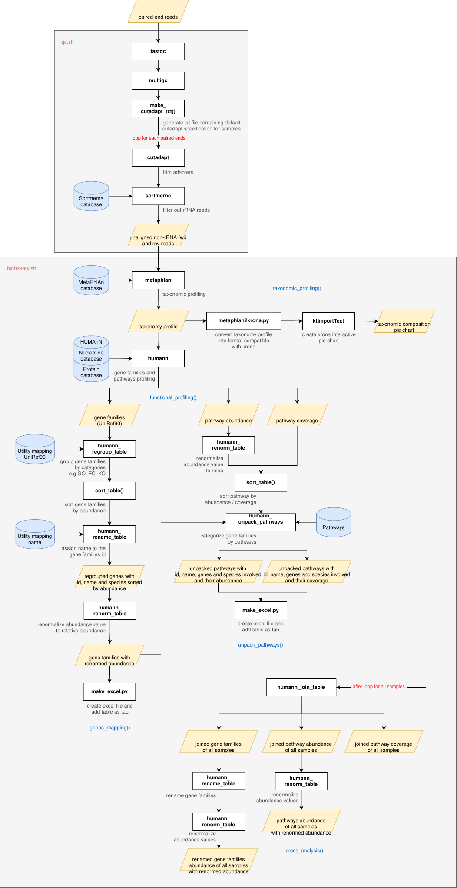

## Metagenomics Analysis Pipeline
<p align="center">
    
</p>

### Environments and Packages
(refer `qc.yml` and `biobakery.yml`)
1. **qc** — fastqc, multiqc, cutadapt, sortmerna
2. **biobakery** — metaphlan, krona, humann, pandas, openpyxl
```bash
    cd <ENV_PATH>
    conda create -n <QC_ENV_NAME> -c bioconda -c conda-forge fastqc multiqc cutadapt sortmerna
    conda create -n <BIOBAKERY_ENV_NAME> -c conda-forge -c bioconda -c biobakery -c defaults python=3.10 metaphlan krona humann=3.9 pandas openpyxl
```

### Database
1. **SortMeRNA database**   [[download-here]](https://github.com/sortmerna/sortmerna/tree/master/test_data/refs)
    contains reference rRNA FASTA files curated from SILVA (archaeal, bacterial and eukaryotic) and Rfam (5s and 5.8S rRNA subunits)
2. **MetapPhlAn database**
    contains ChocoPhlAn SGB (Species-level Genome Bins) marker database
```bash
    conda activate <BIOBAKERY_ENV>
    metaphlan --install --index mpa_vJun23_CHOCOPhlAnSGB_202307
```
3. **HUMAnN database**   [[The Huttenhower Lab]](https://huttenhower.sph.harvard.edu/humann/)
    includes ChocoPhlAn (nucleotide pangenome database), UniRef90 (database of clustered protein sequences), utility mapping (mapping of UniRef90 id to other classification systems)
```bash
    conda activate <BIOBAKERY_ENV>
    PATH=<ENV_PATH>/lib/python3.10/site-packages/humann/data
    humann_databases --download chocophlan full $PATH --update-config yes
    humann_databases --download uniref uniref90_diamond $PATH --update-config yes
    humann_databases --download utility_mapping full $PATH --update-config yes
```

### Guide to Run the Pipeline
0. Set output directories and files path in `lib.sh`
1. **Run QC** `fastqc` and `multiqc` on all paired-end reads
```bash
    conda activate <QC_ENV>
    bash qc.sh all          # run all unfinished steps, OR
    bash qc.sh allforce     # run all steps regardlessly
```
2. **Edit `cutadapt.txt`**
    - detected reads pair(s), default flags and their values are written to the `cutadapt.txt`
    - any missing paired-end reads, please add sample_name, r1 and r2 manualy in a new row
    - based on multiqc report, specifies trimming parameter for each reads pair by:
        - editing cutadapt flag on header row (`cutadapt --help` to refer all flags)
        - editing the values of each column (flag) and row (reads pair)
3. **Resume QC** in terminal [y/n], to perform `cutadapt` and `sortmerna`, pair by pair
```bash
    y
```
4. **Run bioBakery** taxonomic and functional profiling, pair by pair
```bash
    conda activate <BIOBAKERY_ENV>
    bash biobakery.sh all          # run all unfinished steps, OR
    bash biobakery.sh allforce     # run all steps regardlessly
```


### Output Files Structure
```bash
metagenomics_biobakery
├── 0_reads
│   └── (all raw paired-end reads)
├── 1_fastqc
│   ├── <sample_1>_R1_fastqc.html
│   ├── <sample_1>_R1_fastqc.zip
│   ├── <sample_1>_R2_fastqc.html
│   ├── <sample_1>_R2_fastqc.zip
│   ├──            ⋮
│   ├── <sample_n>_R1_fastqc.html
│   ├── <sample_n>_R1_fastqc.zip
│   ├── <sample_n>_R2_fastqc.html
│   └── <sample_n>_R2_fastqc.zip       
├── 2_multiqc
│   ├── multiqc_report.pdf
│   └── multiqc_report_data
├── 3_cutadapt
│   ├── <sample_1>
│   │   ├── <sample_1>_trimmed_R1.fastq
│   │   └── <sample_1>_trimmed_R2.fastq
│   ├──     ⋮
│   ├── <sample_n>
│   └── cutadapt.txt
├── 4_sortmerna
│   ├── <sample_1>
│   │   ├── <sample_1>.fq
│   │   ├── <sample_1>_aligned.log
│   │   ├── <sample_1>_aligned_fwd.fq
│   │   ├── <sample_1>_aligned_rev.fq
│   │   ├── <sample_1>_unaligned_fwd.fq
│   │   ├── <sample_1>_unaligned_rev.fq
│   │   ├── idx
│   │   └── kvdb
│   ├──     ⋮
│   └── <sample_n>
├── 5_metaphlan
│   ├── <sample_1>
│   │   ├── <sample_1>.krona.html   # visualization of taxonomic composition
│   │   ├── <sample_1>_krona.txt
│   │   ├── <sample_1>_metagenome_vJun23.bowtie2.bz2
│   │   └── <sample_1>_taxonomic_profile.tsv
│   ├──     ⋮
│   └── <sample_n>
├── 6_humann
│   ├── <sample_1>
│   │   ├── <sample_1>_genefamilies.tsv
│   │   ├── <sample_1>_pathabundance.tsv
│   │   └── <sample_1>_pathcoverage.tsv
│   ├──     ⋮
│   └── <sample_n>
├── 7_genes_mapping
│   ├── <sample_1>                  # regrouped, renamed, renormed gene families abundance
│   │   ├── <sample_1>_eggnog.tsv
│   │   ├── <sample_1>_go.tsv
│   │   ├── <sample_1>_ko.tsv
│   │   ├── <sample_1>_level4ec.tsv
│   │   ├── <sample_1>_pfam.tsv
│   │   ├── <sample_1>_uniref50.tsv
│   │   ├── <sample_1>_uniref90.tsv
│   │   ├── regrouped
│   │   │   └── ⋮
│   │   ├── renamed
│   │   │   └── ⋮
│   │   └── renormed
│   │       └── ⋮
│   ├──     ⋮
│   └── <sample_n>
├── 8_pathways_analysis
│   ├── <sample_1>                  # renamed, renormed, unpacked pathways
│   │   ├── <sample_1>_pathabundance_unpacked.tsv
│   │   └── <sample_1>_pathcoverage_unpacked.tsv
│   ├──     ⋮
│   └── <sample_n>
├── 9_cross_analysis                # joined table of all samples
│   ├── genefamilies.tsv
│   ├── genefamilies_renormed.tsv
│   ├── pathabundance.tsv
│   ├── pathabundance_renormed.tsv
│   └── pathcoverage.tsv
├── <sample_1>.xlsx                 # excel: per-sample gene families & pathways
│       ⋮
├── <sample_n>.xlsx
├── cross_analysis.xlsx             # excel: cross-sample gene families & pathways
└── logs                            # log files
    └── pipeline_20261113_180933.log
```